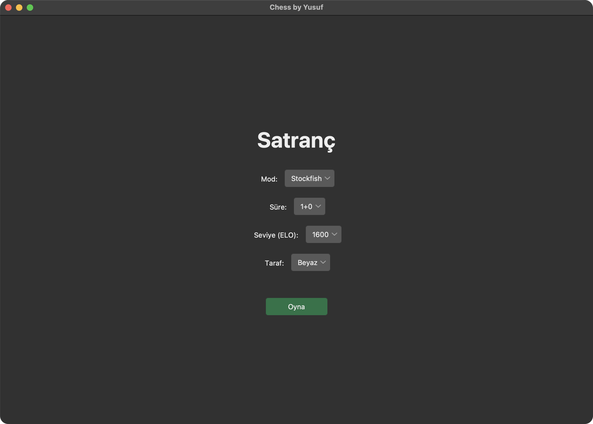
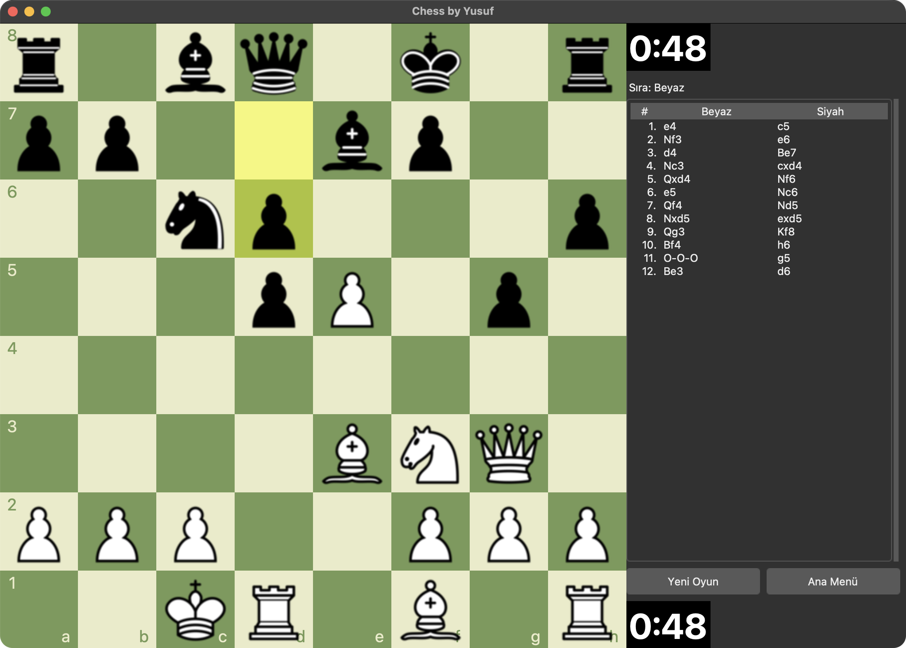
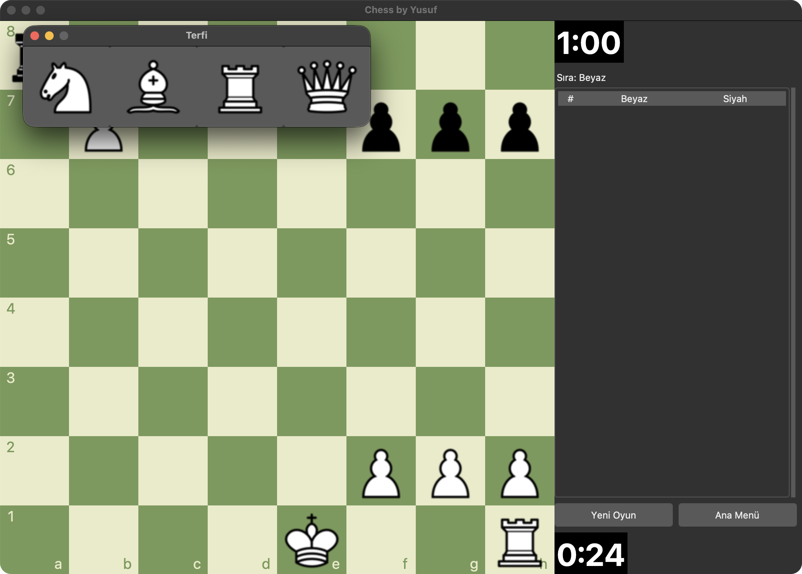
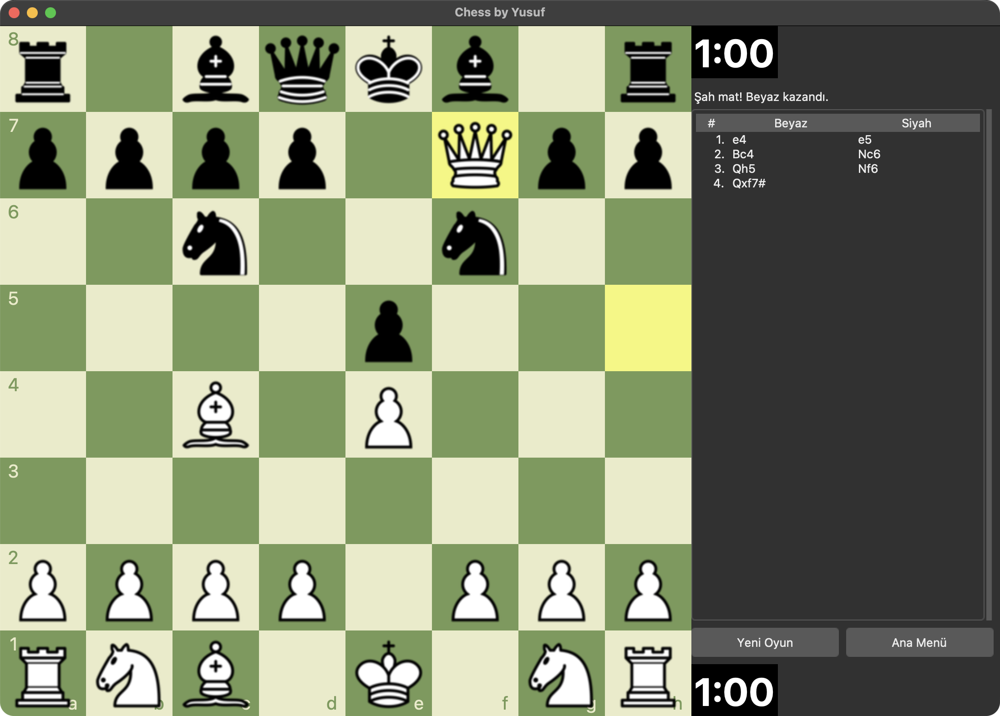
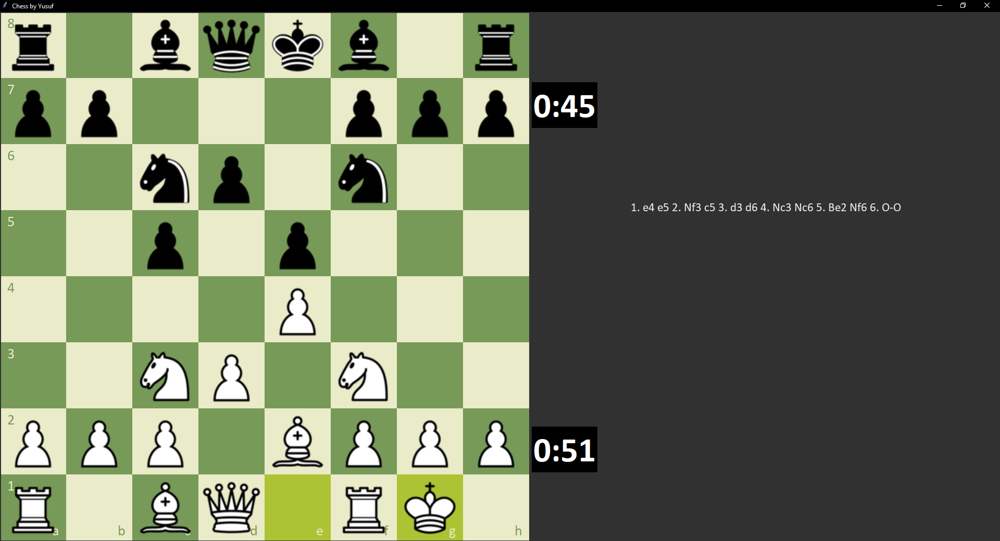

# ♟️ mychess

A desktop chess game written in Python.

`mychess` is a Python-based chess application featuring a graphical interface, chess rule handling, and Stockfish engine integration. The project is built with a modern Python project structure and includes automated tests for core functionality.

## ✨ Features

- ♟️ Full chess gameplay
- 🧠 Stockfish engine integration
- 🖥️ Graphical user interface
- 📋 Legal move validation
- 👑 Standard chess rules and game states
- 🧪 Automated tests with `pytest`
- ⚡ Modern Python project structure
- 📦 Standalone executable support with PyInstaller
- 🔧 Code quality checks with Ruff

## 🛠️ Tech Stack

| Technology | Purpose |
|---|---|
| **Python 3.14+** | Core programming language |
| **python-chess** | Chess rules, board representation and move handling |
| **Pillow** | Image and graphical asset handling |
| **Stockfish** | Chess engine |
| **pytest** | Automated testing |
| **Ruff** | Linting and code quality |
| **PyInstaller** | Application packaging |
| **uv** | Python project and dependency management |

The project's dependencies and development tools are defined in `pyproject.toml`.

## 📁 Project Structure

```text
mychess/
├── engines/
│   └── stockfish_15.1_win_x64_avx2/
├── screenshots/
├── src/
│   └── mychess/
├── tests/
├── Chess.spec
├── pyproject.toml
├── uv.lock
└── README.md
```

## 🚀 Getting Started

### Requirements

- Python **3.14 or newer**
- Git
- `uv` (recommended)

### Clone the repository

```bash
git clone https://github.com/Yusuf-Bayraktar/mychess.git
cd mychess
```

### Install dependencies

Using `uv`:

```bash
uv sync --managed-python
```

`--managed-python` makes uv use its own Python build, which includes Tkinter.

> **macOS:** Homebrew's `python@3.14` ships **without** Tkinter (`_tkinter`), so the game cannot start with it. Use uv's managed Python as shown above (or run `uv python install 3.14` once). If `.venv` was already created with Homebrew's Python, delete it and run `uv sync --managed-python` again.

### Run the game

After installing the dependencies:

```bash
uv run mychess
```

You can also run the application directly through Python:

```bash
uv run python -m mychess
```

The project exposes `mychess` as a console script that starts the game.

## 🧠 Chess Engine

`mychess` includes a Windows Stockfish engine binary under the `engines/` directory.

On macOS (and Linux), install Stockfish yourself:

```bash
brew install stockfish
```

The game looks for the engine in this order: the `MYCHESS_STOCKFISH` environment variable, the bundled engine, `stockfish` on `PATH`, then `/opt/homebrew/bin`, `/usr/local/bin` and `/usr/games`. Without an engine, two-player mode still works.

The **Seviye (ELO)** (rating) option in the menu uses Stockfish's real Elo limit (`UCI_Elo`) when the engine supports that value (1350+ for Stockfish 15.1, 1320+ for newer versions); lower ratings are approximated with `Skill Level` and a search-depth limit.

## 🪵 Logs

When started with `uv run mychess` (or the packaged app), errors and game events are written to a rotating log file:

- macOS: `~/Library/Logs/mychess/mychess.log`
- Windows: `%LOCALAPPDATA%\mychess\logs\mychess.log`
- Linux: `$XDG_STATE_HOME/mychess/mychess.log` (default `~/.local/state/mychess/`)

Error dialogs show the log path when it is available.

## 🧪 Testing

Tests are located in the `tests/` directory and can be executed with:

```bash
uv run pytest
```

## 🔍 Code Quality

Ruff is used for linting and mypy (strict mode) for type checking:

```bash
uv run ruff check .
uv run mypy
```

GitHub Actions (`.github/workflows/ci.yml`) runs Ruff, mypy and the test suite on Linux, macOS and Windows for every push and pull request.

## 📸 Screenshots

| Main menu | Playing against Stockfish |
| :---: | :---: |
|  |  |
| **Pawn promotion** | **Checkmate** |
|  |  |

<details>
<summary>Earlier version (Windows)</summary>



</details>

## 📦 Building

The project includes a PyInstaller specification file:

```text
Chess.spec
```

This can be used to build a standalone executable for the application.

For example:

```bash
uv run pyinstaller Chess.spec --noconfirm
```

The build is written to `dist/Chess/`. On macOS it also produces `dist/Chess.app`, with the Stockfish found on the build machine bundled inside.

## 🗺️ Roadmap

Possible future improvements:

- [ ] Improved game settings
- [ ] Multiple difficulty levels
- [ ] Better engine configuration
- [ ] Game history and move notation
- [ ] Save and load games
- [ ] Additional chess themes
- [ ] More comprehensive test coverage
- [ ] Cross-platform builds

## 👤 Author

**Yusuf Bayraktar**

GitHub: [@Yusuf-Bayraktar](https://github.com/Yusuf-Bayraktar)

## 📄 License

mychess is licensed under the **GNU General Public License v3.0 or later** — see [`LICENSE`](./LICENSE).

It depends on [python-chess](https://github.com/niklasf/python-chess) (GPL-3.0+) and bundles [Stockfish](https://github.com/official-stockfish/Stockfish) (GPL-3.0) in packaged builds. Third-party licenses and source links are listed in [`THIRD_PARTY_NOTICES.md`](./THIRD_PARTY_NOTICES.md); packaged builds include both files under `licenses/`.

---

> ♟️ Built with Python.
